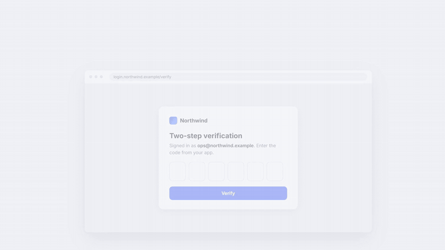
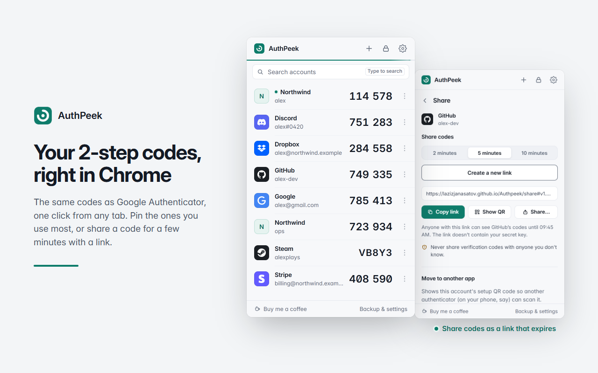
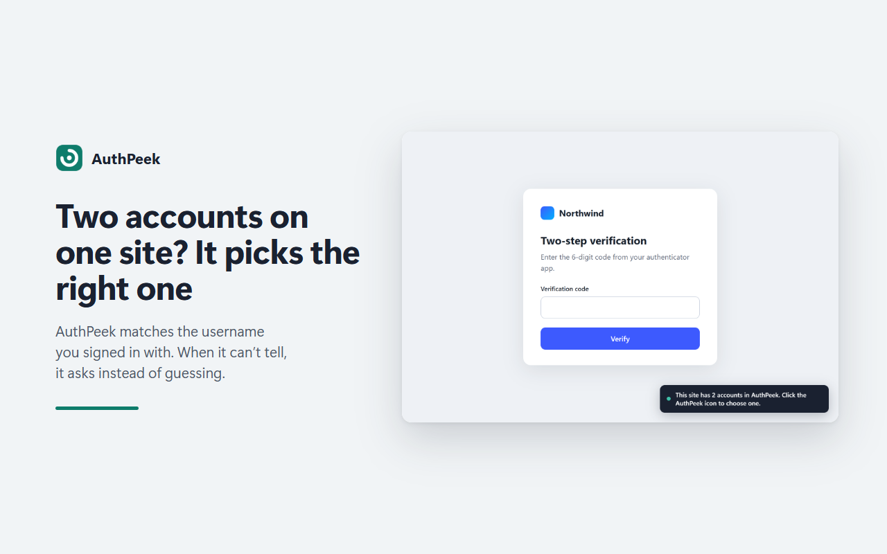
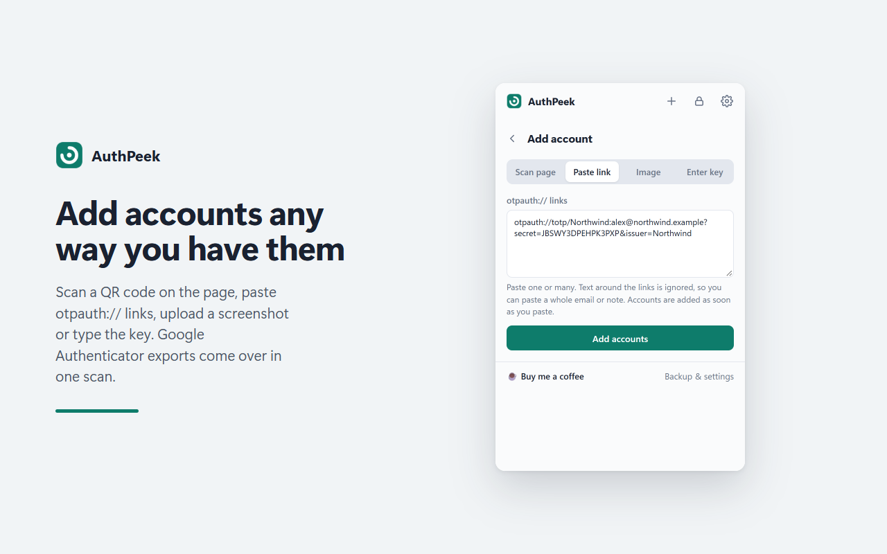
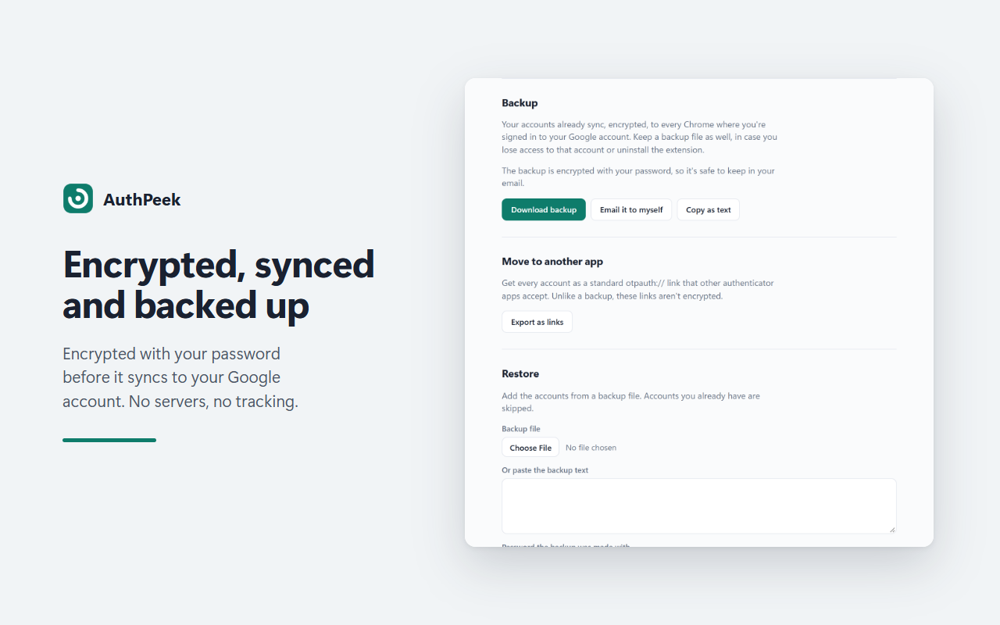

<div align="center">


# AuthPeek

**2-step verification codes in Chrome that fill themselves in.**

An authenticator that lives in your browser: the same 6-digit codes as Google Authenticator,
filled into login pages for you. Encrypted with your password, synced with your Google account,
no servers.

<a href="https://buymeacoffee.com/iamlazizjon"></a>



</div>

## Why

Every 2-step login goes the same way: find your phone, unlock it, open the authenticator, scroll
to the right account, read six digits, type them before the timer runs out. AuthPeek does that
last part for you. You link an account to a site once, and from then on the code is in the box
before you'd have found your phone.

## What it does

<table>
  <tr>
    <td width="50%"></td>
    <td width="50%"></td>
  </tr>
  <tr>
    <td><b>Every code in one place.</b> One countdown for all of them. Type to search by service,
    account, site or initials ("aws"), and pin the ones you use most.</td>
    <td><b>Two accounts on one site?</b> AuthPeek picks the one matching the username you signed in
    with. When it can't tell, it asks instead of guessing, and remembers your choice.</td>
  </tr>
  <tr>
    <td width="50%"></td>
    <td width="50%"></td>
  </tr>
  <tr>
    <td><b>Add accounts any way you have them.</b> Scan the QR code on the page, paste
    <code>otpauth://</code> links, upload a screenshot, or type the key. Google Authenticator's
    <i>Transfer accounts</i> QR codes bring everything over at once.</td>
    <td><b>Yours, and safe.</b> Encrypted before it syncs. Backups you can email to yourself.
    You choose when it asks for your password: after a few minutes, when Chrome starts, or never.</td>
  </tr>
</table>

Also: right-click any text box and choose **AuthPeek** to fill a code yourself, press
**Alt+Shift+O** on a login page, Steam Guard codes, a clock check that fixes codes when your
computer's clock is off, and export to standard `otpauth://` links whenever you want to move on.

## Install

**Chrome Web Store:** in review; the link will be here once it's live.

**From source**, today:

1. Download this repository (Code → Download ZIP) and unzip it.
2. Open `chrome://extensions` and switch on **Developer mode** (top right).
3. Click **Load unpacked** and choose the `extension` folder.
4. Pin AuthPeek from the puzzle-piece menu, click it, and create your password.

Moving from Google Authenticator: in the app, choose **Transfer accounts → Export**, then in
AuthPeek click **+ → Scan page** (or upload a screenshot of the QR code).

## How it keeps your codes safe

- **Encrypted before it's saved.** Each account is encrypted with AES-256-GCM using a key derived
  from your password (PBKDF2-SHA256, 600,000 rounds). Your password is never stored. Chrome sync
  carries only the encrypted data, so Google can't read it.
- **No servers.** Nothing is sent to the developer or anyone else. The one network request is an
  optional clock check against Cloudflare's public time service.
- **No look-alike fills.** A code is only filled on the exact site you linked (or its subdomains),
  so a phishing page at a similar address gets nothing.
- **Open source.** Everything above can be checked in [`extension/`](extension). Privacy policy:
  [lazizjanasatov.github.io/Authpeek/privacy.html](https://lazizjanasatov.github.io/Authpeek/privacy.html).

## Support

AuthPeek is free and has no ads or tracking. If it saves you time, you can
[buy me a coffee](https://buymeacoffee.com/iamlazizjon). Found a bug or have an idea?
[Open an issue](https://github.com/LazizjanAsatov/Authpeek/issues).

---

## Development

No build step: the `extension` folder is the extension.

```bash
npm install
```

```bash
npm test
```

```bash
npm run e2e
```

`npm test` runs the unit tests: codes against the RFC 6238 vectors, Steam codes against an
independent library, link and Google Authenticator export parsing, encryption, the synced vault,
site and username matching, and code-field detection on sample pages. `npm run e2e` loads the
extension into a throwaway Chrome profile and checks the real flows: adding accounts, auto-fill,
two accounts on one site, locking, settings actions, restarts.

| Command | What it makes |
| --- | --- |
| `npm run package` | `dist/authpeek.zip` for the Chrome Web Store |
| `npm run store-assets` | Store screenshots and promo tiles in `docs/store`, from the real extension |
| `npm run build:firefox` | `dist/firefox`, checked with Mozilla's validator (not yet tried in a real Firefox) |

Publishing steps: [docs/deploy-checklist.md](docs/deploy-checklist.md).
Store texts and permission justifications: [docs/store-listing.md](docs/store-listing.md).

### How it fits together

| File | Job |
| --- | --- |
| `extension/lib/totp.js`, `base32.js` | Code generation (including Steam Guard) |
| `extension/lib/otpauth.js` | Reads QR contents and links, including Google Authenticator exports |
| `extension/lib/crypto.js` | Password-based encryption for the vault and backups |
| `extension/lib/vault.js` | Encrypted accounts in `chrome.storage.sync`; unlock key in `chrome.storage.session` |
| `extension/lib/sites.js` | Which account belongs to which site |
| `extension/lib/identity.js` | Which of a site's accounts is signing in, by username |
| `extension/lib/search.js` | Popup search and pinning |
| `extension/lib/menus.js` | Right-click menu items |
| `extension/lib/clock.js` | Clock check and correction |
| `extension/otp-detect.js` | Finds and fills code fields (content script, no Chrome APIs) |
| `extension/content.js` | Watches pages and asks the background for a code |
| `extension/background.js` | Hands codes only to frames whose site is linked; shortcut; right-click menu |
| `extension/popup.*` | Codes list, add/scan, edit |
| `extension/options.*` | Settings, backup, restore, export, password |
