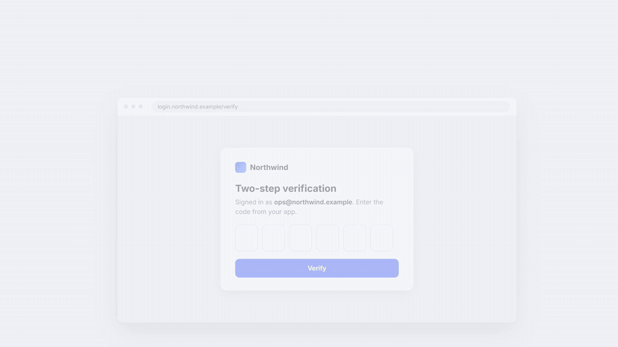
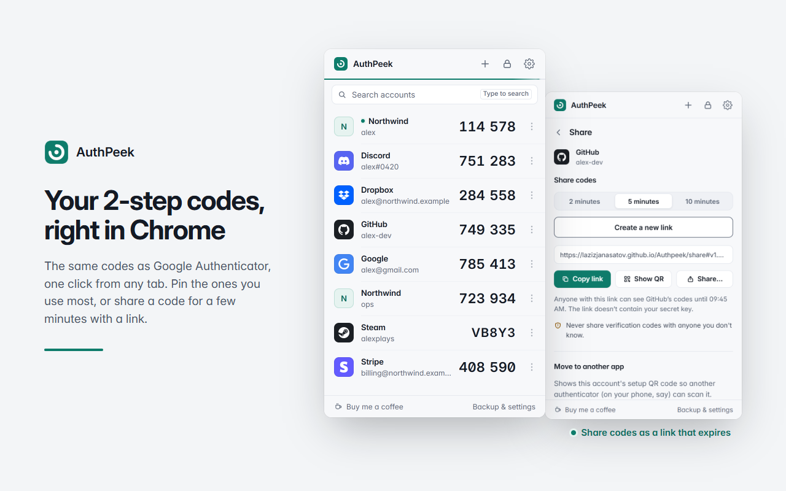
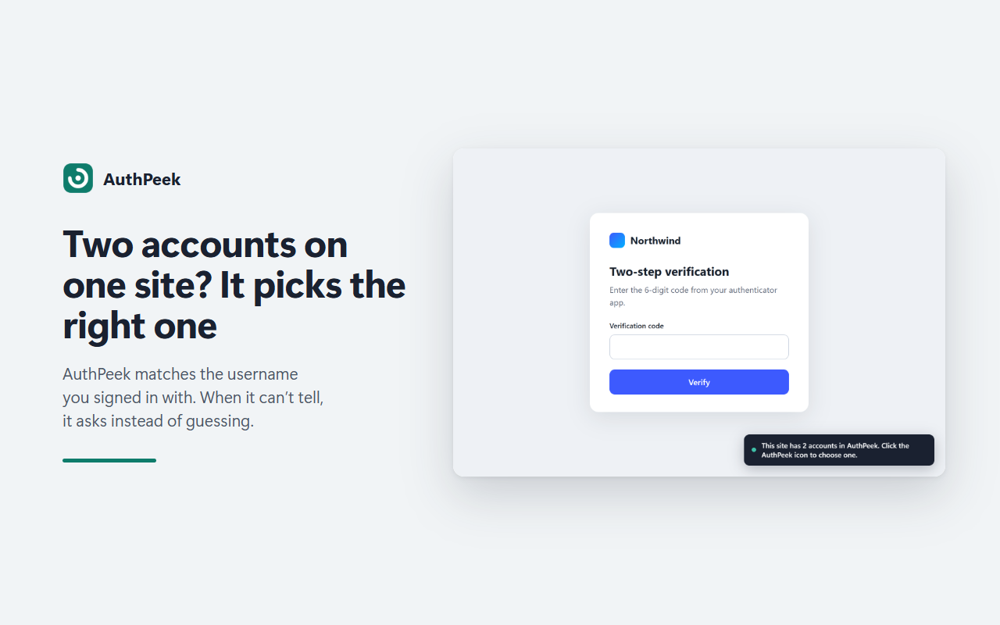
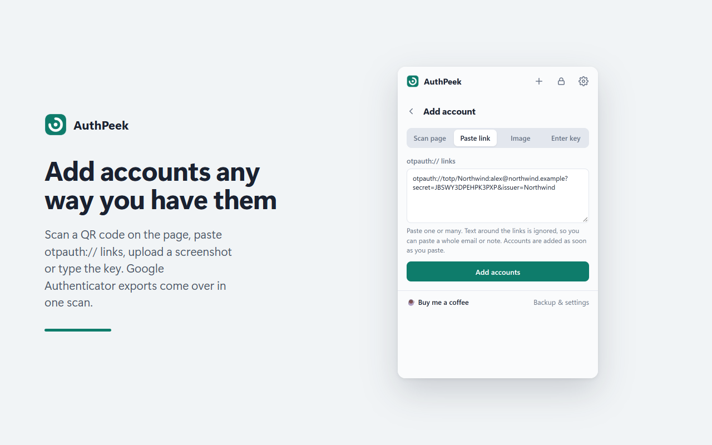
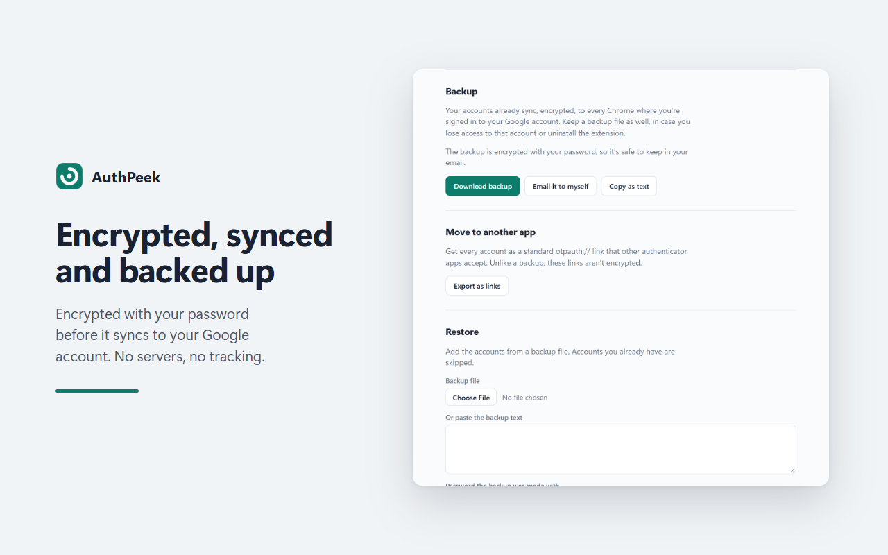

<div align="center">


# AuthPeek

**2-step verification codes in Chrome that fill themselves in.**

An authenticator that lives in your browser: the same 6-digit codes as Google Authenticator,
filled into login pages for you. Encrypted with your password, synced with your Google account,
no servers.

<a href="https://buymeacoffee.com/iamlazizjon"></a>



</div>

## Why

Every 2-step login goes the same way: find your phone, unlock it, open the authenticator, scroll
to the right account, read six digits, type them before the timer runs out. AuthPeek does that
last part for you. You link an account to a site once, and from then on the code is in the box
before you'd have found your phone.

## What it does

<table>
  <tr>
    <td width="50%"></td>
    <td width="50%"></td>
  </tr>
  <tr>
    <td><b>Every code in one place.</b> One countdown for all of them. Type to search by service,
    account, site or initials ("aws"), and pin the ones you use most.</td>
    <td><b>Two accounts on one site?</b> AuthPeek picks the one matching the username you signed in
    with. When it can't tell, it asks instead of guessing, and remembers your choice.</td>
  </tr>
  <tr>
    <td width="50%"></td>
    <td width="50%"></td>
  </tr>
  <tr>
    <td><b>Add accounts any way you have them.</b> Scan the QR code on the page, paste
    <code>otpauth://</code> links, upload a screenshot, or type the key. Google Authenticator's
    <i>Transfer accounts</i> QR codes bring everything over at once.</td>
    <td><b>Yours, and safe.</b> Encrypted before it syncs. Backups you can email to yourself.
    You choose when it asks for your password: after a few minutes, when Chrome starts, or never.</td>
  </tr>
</table>

Also: share a code with someone as a link that works for a few minutes (encrypted, no server,
your secret key never leaves the browser), move an account to your phone with a QR code,
right-click any text box and choose **AuthPeek** to fill a code yourself, press **Alt+Shift+O** on
a login page, Steam Guard codes, a clock check that fixes codes when your computer's clock is off,
light and dark themes, and export to standard `otpauth://` links whenever you want to move on.

## What's new in 1.3

- **No more lockout loops.** If a site rejects a code and reloads, AuthPeek used to fill it again
  and again until the site locked the account. Now it fills a code by itself once per account and
  site in 10 minutes (and at most 3 times per site); after that a small card on the page offers the
  code, and you fill it with one click. "Press Verify" only presses when the code is still in the box
  and the page hasn't already sent it.
- **Whitelisted IPs.** Settings → Whitelisted IPs: list your office or VPN addresses (or an internal
  https:// address), and codes are shown, filled, copied, shared and exported only on those networks.
  Every change needs your password, the list syncs encrypted with your accounts, and if the network
  can't be checked, codes stay hidden.
- **Codes only go to the site they're for.** Auto-fill, the popup, the right-click menu and
  Alt+Shift+O name the site with every code, and a page on any other site, such as an embedded frame,
  refuses it.
- **Rewritten privacy policy and new terms of use**, linked from Settings → About and the welcome page.

## Install

**Chrome Web Store:** in review; the link will be here once it's live.

**From source**, today:

1. Download this repository (Code → Download ZIP) and unzip it.
2. Open `chrome://extensions` and switch on **Developer mode** (top right).
3. Click **Load unpacked** and choose the `extension` folder.
4. Pin AuthPeek from the puzzle-piece menu, click it, and create your password.

Moving from Google Authenticator: in the app, choose **Transfer accounts → Export**, then in
AuthPeek click **+ → Scan page** (or upload a screenshot of the QR code).

## How it keeps your codes safe

- **Encrypted before it's saved.** Each account is encrypted with AES-256-GCM using a key derived
  from your password (PBKDF2-SHA256, 600,000 rounds). Your password is never stored. Chrome sync
  carries only the encrypted data, so Google can't read it.
- **No servers.** Nothing is sent to the developer or anyone else. The only network requests go to
  Cloudflare's public trace service: an optional clock check and, if you turn on Whitelisted IPs, a
  check of this computer's public IP.
- **No lockout loops.** One automatic fill per account and site in 10 minutes; after that AuthPeek
  only suggests the code.
- **No look-alike fills.** A code is only filled on the exact site you linked (or its subdomains),
  so a phishing page at a similar address gets nothing.
- **Open source (MIT).** Everything above can be checked in [`extension/`](extension). Privacy policy:
  [lazizjanasatov.github.io/Authpeek/privacy.html](https://lazizjanasatov.github.io/Authpeek/privacy.html);
  terms of use: [lazizjanasatov.github.io/Authpeek/terms.html](https://lazizjanasatov.github.io/Authpeek/terms.html).

## Support

AuthPeek is free and has no ads or tracking. If it saves you time, you can
[buy me a coffee](https://buymeacoffee.com/iamlazizjon). Found a bug or have an idea?
[Open an issue](https://github.com/LazizjanAsatov/Authpeek/issues).

---

## Development

No build step: the `extension` folder is the extension.

```bash
npm install
```

```bash
npm test
```

```bash
npm run e2e
```

`npm test` runs the unit tests: codes against the RFC 6238 vectors, Steam codes against an
independent library, link and Google Authenticator export parsing, encryption, the synced vault,
site and username matching, code-field detection on sample pages, the background's fill gate and
fill log (one automatic fill, then a suggestion), and Whitelisted IPs (address parsing, the network
check, the rules for exports and share links). `npm run e2e` loads the
extension into a throwaway Chrome profile and checks the real flows: adding accounts, auto-fill,
two accounts on one site, the suggestion card after a first fill, Whitelisted IPs hiding codes and
refusing share links, locking, settings actions, restarts, share links and the viewer page.
`node scripts/qa-server.mjs` serves local pages that reject every code, for checking the loop fix
by hand ([planning/qa-manual-test.md](planning/qa-manual-test.md)).

| Command | What it makes |
| --- | --- |
| `npm run package` | `dist/authpeek.zip` for the Chrome Web Store |
| `npm run store-assets` | Store screenshots and promo tiles in `docs/store`, from the real extension |

Publishing steps: [docs/deploy-checklist.md](docs/deploy-checklist.md).
Store texts and permission justifications: [docs/store-listing.md](docs/store-listing.md).

### How it fits together

| File | Job |
| --- | --- |
| `extension/lib/totp.js`, `base32.js` | Code generation (including Steam Guard) |
| `extension/lib/otpauth.js` | Reads QR contents and links, including Google Authenticator exports |
| `extension/lib/crypto.js` | Password-based encryption for the vault and backups |
| `extension/lib/vault.js` | Encrypted accounts in `chrome.storage.sync`; unlock key in `chrome.storage.session` |
| `extension/lib/sites.js` | Which account belongs to which site |
| `extension/lib/identity.js` | Which of a site's accounts is signing in, by username |
| `extension/lib/search.js` | Popup search and pinning |
| `extension/lib/menus.js` | Right-click menu items |
| `extension/lib/clock.js` | Clock check and correction |
| `extension/lib/gate.js` | The background's decision for every fill: linked site, Whitelisted IPs, one automatic fill, else a suggestion |
| `extension/lib/attempts.js` | The fill log in `chrome.storage.session` (no codes, only the 30-second step) |
| `extension/lib/networks.js`, `netcheck.js`, `access.js` | Whitelisted IPs: address rules, the public-IP check (fails closed), one "allowed?" answer for every page; `exportGate` for backups, exports and share links |
| `extension/lib/whitelist-ui.js` | Words for Whitelisted IPs and the "already filled" line |
| `extension/lib/share.js` | Share links: a few minutes of codes, encrypted into the link itself |
| `extension/lib/logos.js` | Bundled service logos (Simple Icons table written by `scripts/build-logos.mjs`) |
| `extension/lib/theme.js`, `theme-boot.js` | Light, dark or system theme, applied before the page first draws |
| `extension/vendor/qrcode.js` | Draws QR codes for share links and the setup QR |
| `extension/otp-detect.js` | Finds and fills code fields (content script, no Chrome APIs) |
| `extension/content.js` | Watches pages, asks the background for a code, and shows the suggestion card after a first fill |
| `extension/background.js` | Hands codes only to frames whose site is linked (through `lib/gate.js`); shortcut; right-click menu |
| `extension/popup.*` | Codes list, add/scan, edit, share |
| `extension/options.*` | Settings, backup, restore, export, password |
| `extension/welcome.*` | Page opened once, on first install |
| `extension/privacy.html`, `terms.html` | Privacy policy and terms of use (copies with the site's styling in `docs/`) |
| `docs/share.*` | The page a share link opens; its own copy of the decoder (kept in step by `test/share-viewer.test.js`) |

## License

MIT, see [LICENSE](LICENSE). Bundled third-party files keep their own licences: jsQR (Apache-2.0),
qrcode-generator (MIT), the Inter font (SIL OFL 1.1) and the Simple Icons logo paths (CC0 1.0).

---

<sub>Google Authenticator and Chrome are trademarks of Google LLC. Other names are trademarks of their
owners; AuthPeek is not affiliated with them.</sub>
